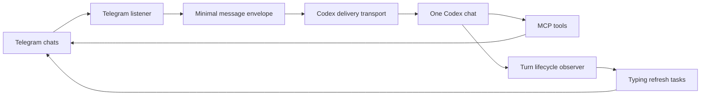

# Bridges MCP design

Design and implementation constraints · 2026-11-14

Bridges MCP connects external message sources to one Codex chat and gives the
agent tools to communicate back. The first implementation is Telegram. Incoming
messages must join an active turn immediately or wake an idle chat. The project
uses the user's Codex subscription, without an OpenAI API key.

This document records the agreed product behavior and proposes concrete defaults
where the discussion left implementation choices open. Current validation
evidence and remaining acceptance checks are recorded in [docs/validation.md](docs/validation.md).

## Agreed scope

- One installable application owns external listeners, Codex delivery, and MCP
  tools. The user should not operate a separate incoming-message service.
- Support multiple bridge types and multiple connections of each type. Implement
  Telegram first; leave Discord and cron integrations for later.
- All configured connections feed one dedicated Codex chat. Support the desktop
  app and a persistent Codex session on a VPS through internal transport modules.
- Steer active turns; start work when idle. Do not routinely queue messages until
  the active turn finishes.
- Emit only incoming text, audio, image, and file messages. No reaction, edit,
  deletion, delivery receipt, typing, presence, or connection-status events enter
  the agent's conversation.
- Keep inbound metadata small. No durable inbox, replay service, or exactly-once
  guarantee is required. Losing messages is acceptable initially.
- Everyone in a configured external conversation may instruct the agent. There
  is no sender approval workflow in v1. Existing Codex permissions still apply.
- The bridge provides communication mechanisms. User instructions determine
  where to send replies or future cron results; no automatic routing policy.
- Hide tools and protocol documentation for unconfigured bridge types.
- Telegram typing refreshes automatically after activation, until explicitly
  disabled or the owning Codex turn finishes.

## Architecture and ownership



All bridge components in the diagram belong to the same application. A Codex
transport is a code module, not a separately deployed adapter service. It exposes
binding, delivery, turn lifecycle observation, and shutdown. It returns explicit
delivery outcomes: accepted, definitely rejected, or unknown.

Use one listener per bot account, with routing to its configured conversations.
Two connections sharing one bot must not create competing update pollers. Use a
single-instance lock for each configured bridge instance; a second process must
report the conflict rather than duplicate listeners. No general plugin loader or
message broker is needed initially.

Implementation: asynchronous Python and the official MCP SDK. Desktop IPC framing
and host metadata handling live in the production transport and binding modules.
Tests exercise those modules directly; no separate test bridge is required.

### Desktop deployment

The desktop app launches Bridges MCP over stdio. That process owns Telegram
listeners and connects to the existing desktop session. It lives while its MCP
connection lives; it is not an always-running daemon when the app is closed.
One selected chat binds the instance during protocol initialization.

If the desktop launches another MCP process for another chat, that process must
not steal the binding or poll the same bot. Return a clear instance/binding error.
An automatic shared daemon for many desktop MCP clients is out of scope for v1.

### VPS deployment

Provide a single application entry point that owns a persistent Codex App Server
child process and the bridge runtime. Expose the same MCP tools to that Codex
process through a loopback-only MCP endpoint. Configure its bridge entry to use
that endpoint, not spawn a second copy of the listener application. Start the
endpoint before initializing the Codex chat.

Authenticate Codex using the user's existing subscription login on the VPS.
Do not copy credentials from the desktop or introduce an API-key fallback.
Persist the chat binding so the application can resume the same chat after a
restart; this small configuration state is separate from a durable inbox.
The user can run the one application under their normal process supervisor.

This VPS lifecycle is a proposed implementation design. Subscription login,
resumption, active steering, and MCP attachment still require an integrated test.

## Configuration

Proposed configuration shape:

```yaml
instance_id: personal
codex:
  mode: desktop                  # desktop | app_server
  # Desktop: bind using host metadata on the first get_protocol_docs call.
  # VPS: create/resume one chat and persist its binding outside this file.
telegram:
  bots:
    main:
      token_env: TELEGRAM_BOT_TOKEN
  connections:
    personal:
      bot: main
      chat_id: "123456789"
    team:
      bot: main
      chat_id: "-1001234567890"
      # message_thread_id: 42     # optional topic-specific connection
```

Connection IDs are strings and unique within a bridge type. Each Telegram
connection maps to a bot, chat, and optional topic. Keep chat IDs as strings at
the configuration boundary. Reject overlapping routes that would deliver the
same update twice; for example, an all-topics chat route plus a topic route for
that same bot/chat.

Bot tokens are resolved from environment variables and never included in tool
responses, protocol docs, message envelopes, or logs. A connection with invalid
configuration fails startup validation. A temporary Telegram outage keeps its
configured tools visible and returns operational errors when needed.

An absent or empty Telegram connections list means no Telegram listeners, tools,
or protocol section. Keep `get_protocol_docs` available even when no bridge is
configured. Configuration changes require restart in v1; live reconfiguration
is not required.

## Agent initialization and chat binding

MCP server instructions must say:

> At the start of this chat, call `bridges.get_protocol_docs()` and discover the
> available Bridges MCP tools using the host's tool discovery mechanism. Do this
> before responding to a message with `bridge_context` metadata. Messages to
> external conversations must be sent using Bridges MCP tools. Ordinary assistant
> responses in the Codex chat are not delivered externally.

`get_protocol_docs()` returns the envelope specification, configured connection
IDs and useful labels, enabled bridge behavior, available reply/download tools,
typing semantics, and binding status. It does not return tokens or full config.
The docs and tool registry are generated from the same enabled-bridge registry.
The host performs MCP `tools/list`; do not assume the agent has a literal
`tools/list` function. See the [MCP tools specification](https://modelcontextprotocol.io/specification/2025-11-25/server/tools).

On desktop, the first successful docs call captures the host-provided
`_meta.threadId`. Do not take a destination from message text, process cwd, the
most recent chat, or a guessed environment variable. Persist the binding with
the instance identity. Later calls from another chat must not silently rebind.
An explicit local setup/reset operation may replace the binding.

Validate host-provided chat identity on all communication tool calls, not just
bootstrap. A tool call from a different chat must not send through the bound
instance or alter its typing tasks.

The MCP startup handshake alone does not supply chat identity. Require
one initial user interaction in the selected chat to run bootstrap before
starting external polling. On restart, an existing binding may be reused only
after validating that its target is reachable. On VPS, the application already
knows the chat it created/resumed and checks MCP calls against that binding.

## Inbound format

Text example:

````text
```yaml
bridge_context:
  bridge: telegram
  connection_id: personal
  received_at: "2026-11-14T15:08:31Z"
```

Hello world!
````

Attachment example:

````text
```yaml
bridge_context:
  bridge: telegram
  connection_id: personal
  received_at: "2026-11-14T15:08:31Z"
  attachments:
    - type: image
      id: a_7f2c
```

Can you explain this picture?
````

Only `bridge`, `connection_id`, and `received_at` are required. The timestamp is
bridge receipt time in UTC to seconds, with an explicit `Z`. Optional attachment
types are `image`, `audio`, and `file`. Text messages need no separate event type.
Keep the original text/caption in the body; an attachment-only body may be empty.
Do not add redundant JSON payloads, event wrappers, empty fields, or per-message
copies of the protocol docs.

Use a YAML serializer for metadata inside a triple-backtick `yaml` code fence,
followed by a blank line and the original body. Do not emit a `---` separator.
Treat everything after the closing metadata fence and blank line as body text,
even if it resembles another header or code fence. This presentation was updated
at the user’s request after the live desktop test on 2026-11-14. Construct
the header from bridge-controlled routing data. Optional `sender` display text
may be included for group conversations when needed to distinguish participants;
it is descriptive, not a permission or authority claim.

Attachment IDs are opaque bridge handles scoped to the bot and connection. Keep
Telegram file identifiers and routing details server-side in a bounded in-memory
map. Proposed default: retain handles for 24 hours, with a bounded entry count.
Expiration or restart may make old handles unavailable; report that explicitly.
File name, MIME type, and size belong in download results unless needed earlier.

## Telegram input handling

Use long polling so desktop and VPS setup need no public webhook endpoint.
Telegram's `getUpdates` supports offsets and allowed update types, and cannot run
alongside a configured webhook. See [Telegram update delivery](https://core.telegram.org/bots/api#getupdates).

Proposed v1 mapping:

| Telegram payload | Bridge representation |
| --- | --- |
| Text message | Body text |
| Photo | One image handle, selecting the largest available variant |
| Voice note or audio | One audio handle |
| Document | One file handle, including documents whose MIME type is an image |
| Caption | Body of the attachment message |
| Other payloads | Ignore in v1 |

Limit v1 to private/group/supergroup messages and optional topic routing.
Channel posts, video-specific handling, transcription, and album coalescing are
not required. An album may yield one envelope per constituent message; do not
emit a separate album event. Ignore service messages and edits even if received.

Configure supported updates explicitly and filter again locally. Do not remove
an existing webhook silently; surface a setup conflict. Document how to create
the bot, supply its token, discover chat IDs, and invite it to configured chats.
Group visibility depends on Telegram privacy mode and bot permissions; “everyone
may instruct” does not make otherwise hidden messages visible. See the
[Telegram bot FAQ](https://core.telegram.org/bots/faq#what-messages-will-my-bot-get).

Maintain update offsets and a small duplicate cache in memory. Advance past
handled or deliberately dropped updates even if Codex delivery fails. Restart
may replay Telegram's still-pending updates; no replay or no-replay guarantee is
made. Do not wait for a Codex turn to finish before accepting another update.
Use bounded buffers and log dropped messages locally on overflow.

## Telegram MCP tools

Register the MCP server as `bridges`, with tool names below. The host may display
its own namespace prefix; `bridges.telegram_send_text` is the conceptual name.
Every Telegram tool accepts an optional `connection_id`. It may be omitted only
when exactly one Telegram connection is configured; otherwise return an
ambiguity error. Never choose the last active connection implicitly.

| Tool | Arguments besides `connection_id` | Result |
| --- | --- | --- |
| `get_protocol_docs` | None; no connection argument | Enabled protocols, connections, bootstrap and delivery rules |
| `telegram_send_text` | `text: string` | Sent message ID |
| `telegram_send_images` | `paths: string[]`, optional `caption: string` | Sent message IDs |
| `telegram_send_file` | `path: string`, optional `caption: string` | Sent message ID |
| `telegram_download_images` | `attachment_ids: string[]` | Local paths, image metadata, image content when supported |
| `telegram_download_file` | `attachment_id: string` | Local path, name, MIME type, byte size; also accepts audio handles |
| `telegram_set_typing` | `enabled: boolean` | Requested typing state and owning turn ID when enabled |

Example calls:

```text
bridges.telegram_send_text(connection_id="team", text="The job finished.")
bridges.telegram_download_file(connection_id="personal", attachment_id="a_91bf")
bridges.telegram_set_typing(connection_id="personal", enabled=True)
bridges.telegram_set_typing(connection_id="personal", enabled=False)
```

Proposed outbound defaults: plain text, no implicit formatting parse mode, and no
automatic forwarding of final Codex answers. Send images in supplied order;
multiple images may be sent individually in v1, with the caption on the first.
Validate payloads against current Telegram limits before sending. Return a clear
error for oversize text/captions rather than silently truncating them. For a
partially completed image batch, return completed message IDs and the failed
index; never invite a blind retry of the entire batch.

Downloads use `getFile` and internal authenticated retrieval. Telegram-hosted
downloads currently have a 20 MB limit. Do not expose token-bearing download URLs.
See [Telegram file retrieval](https://core.telegram.org/bots/api#getfile).

Use generated local filenames inside a configured download directory; preserve
the original name as metadata. Resolve handles only for their bound connection.
Upload paths must be readable local files on the bridge host. The Codex session
and bridge should share a host/filesystem in v1; a desktop cannot dereference a
VPS path automatically. Image downloads should expose MCP image content where
the host supports it, rather than assuming a path makes the image visible.
Downloading audio does not imply transcription; no paid speech API is introduced.

Tool execution failures use MCP `isError: true` with a concise machine-readable
code and explanation. Useful codes include `unknown_connection`,
`ambiguous_connection`, `attachment_expired`, `invalid_attachment_type`,
`file_too_large`, `telegram_unavailable`, and `delivery_unknown`. Do not report
success until the upstream operation acknowledges it. Rate limits may be retried
when non-delivery is definite; ambiguous send timeouts must not be retried blindly.

## Typing lifecycle

`telegram_set_typing(True)` means maintain typing for this connection throughout
the calling Codex turn. It is an ongoing task, not a single Telegram action.

Telegram's `sendChatAction` typing status lasts at most five seconds and may be
cleared by a bot message. There is no explicit cancellation action. See
[Telegram typing actions](https://core.telegram.org/bots/api#sendchataction).

Implementation contract:

1. Resolve the connection and authoritative calling turn ID. Send typing once
   immediately, then refresh approximately every four seconds.
2. Keep one task per connection, associated with that turn ID and a generation
   token. Repeated `True` within the same turn is idempotent.
3. `False` cancels refreshes for that connection and is idempotent. Synchronize
   cancellation with pending refreshes so an old task cannot restart itself.
4. Completion, interruption, or failure of the owning turn cancels its refreshes.
   A later turn must explicitly enable typing again. An older turn's completion
   must not cancel a task newly owned by a different turn.
5. Sending a Telegram message does not disable refreshes. If the client clears
   the indicator, the next refresh restores it while the turn remains active.
6. Shutdown, loss of the Codex lifecycle connection, or inability to verify the
   owning turn stops refreshes. This prevents an orphaned indicator. On recovery,
   do not resurrect typing without checking ownership and current turn state.

`False` and turn completion stop future refreshes; the visible indicator may
linger for the remaining Telegram expiry interval. Do not claim instant visual
cancellation. Keep rate-limit/error handling inside the refresher and logs;
never generate typing-status messages in the agent conversation.

The turn ID must come from Codex metadata/lifecycle state, not an agent-supplied
tool argument. If the transport cannot identify and observe the active turn,
return a capability error for `True` rather than start an unbounded refresher.

## Codex delivery

### Standalone App Server

Maintain an authenticated local connection to the bridge-owned App Server.
Seed status on connection/resumption and track turn start/completion and thread
status notifications (`turn/started`, `turn/completed`, and
`thread/status/changed`). Use `thread/read` for a status snapshot and reconcile
the active turn ID from turn state. Clear a saved turn ID only when the completion
matches it; ignore stale completion events for older turns. The protocol supports
`turn/start`, `turn/steer`, and lifecycle notifications; inspect the installed
version's generated schema during implementation. See the
[App Server protocol](https://learn.chatgpt.com/docs/app-server).

| State | Delivery action |
| --- | --- |
| Active with known turn ID | `turn/steer` using `expectedTurnId` |
| Idle | `turn/start` |
| Not loaded | Resume the bound chat, then reconcile state |
| Disconnected, error, or uncertain | Reconnect/reconcile, or drop with a local diagnostic |

Waiting for approval or user input is an active state, not idle. Steering does
not approve an operation or answer a pending approval automatically. Its behavior
in these states must be tested. Do not bypass the user's existing Codex policy.

Serialize delivery decisions per chat, but release the lock once submission is
acknowledged: never hold it for the duration of a model turn. If state changes
between checking and submitting, reconcile and make one bounded retry only after
a definite non-delivery response. A timeout or lost response is an unknown
outcome; do not blindly call `turn/start` and risk duplicate execution.

### Desktop app

The verified path uses the same-user desktop coordination socket, conventionally
`~/.codex/ipc/ipc.sock`, to discover the bound chat's owner and forward a
`thread-follower-steer-turn` request. The owner selects the actual active turn.
This is internal, version-specific IPC. Check socket ownership and surface
incompatibility; do not modify app authorization or impersonate another client.

Idle delivery was separately verified through `codex queue --thread … --message
…` for a loaded idle desktop chat. Active delivery must use steering. Do not
use queue as the default for every message or as fallback after an ambiguous
steering failure.

The desktop state/lifecycle observer uses the owner's snapshot and revisioned
patch stream to stop typing at turn completion and reconcile state. Do not read
chat history on every typing refresh. Revalidate this private interface after
desktop upgrades before claiming compatibility.

For desktop idle wake-up, a state check followed by `codex queue` is not atomic:
another actor may start a turn between those operations. Resolve this with a
verified owner-side delivery operation if available, or explicitly test and
document the narrow race. Do not claim the combination already guarantees
immediate steering in every race. App-closed and unloaded-chat wake-up remain
outside the demonstrated support boundary.

## Evidence and remaining validation

Tests used desktop-bundled Codex `0.169.0-alpha.11.1` on 2026-11-14. Current
evidence and acceptance boundaries are in [docs/validation.md](docs/validation.md).

| Behavior | Evidence |
| --- | --- |
| MCP identifies the calling desktop chat | Verified through `_meta.threadId` |
| Desktop active-turn delivery from a real MCP process | Verified; injected message and acknowledgment retained the same turn ID |
| Loaded desktop idle chat wakes | Verified through CLI queue after prior turn completion |
| Standalone `turn/steer` on a fresh idle chat | Verified rejection: `-32600`, `no active turn to steer` |
| Standalone subscription login and active steering | Not yet integration-tested |
| Desktop lifecycle observer and automatic active/idle routing | Implemented; live active subscription and steering verified, idle queue race documented |
| Telegram tools, listeners, and typing lifecycle | Implemented; live sends/downloads/refresh verified, completion cancellation covered by deterministic tests |

The idle App Server test used an isolated ephemeral chat without a model request.
It establishes idle rejection, not subscription authentication or post-turn
reconnection behavior. Do not substitute it for a full VPS integration test.

## Implementation and acceptance

The implementation includes the Telegram registry, config validation, envelope
encoder, handles, tools, binding, delivery, lifecycle observation, and typing.
Complete the desktop acceptance checks before describing it as plug and play.
Keep the VPS path isolated until its full lifecycle is tested; do not advertise
it as finished solely because the wire methods exist.

Required checks:

- Bootstrap binds only the intended chat; restarting preserves the binding;
  another chat/process cannot silently take it over.
- Two connections sharing one bot use one poller and route independently into
  the same Codex chat. Unconfigured conversations are ignored.
- No configured Telegram connections means no Telegram tools or protocol section.
- Each supported payload produces one minimal envelope; excluded updates produce
  none. Image/audio/file handles download correctly and fail clearly after expiry.
- All send tools reach the selected external conversation. Ordinary assistant
  prose is not forwarded. Ambiguous destination and partial-send errors are clear.
- Real incoming Telegram messages steer a busy chat and wake an idle chat.
  A burst does not wait for the model to finish. Test turn-boundary races and
  uncertain responses without duplicate resubmission.
- Typing refreshes across multiple intervals, stops after `False` and after
  turn completion/failure/interruption, and survives ordinary outbound sends.
  Test two connections, repeated `True`, old-turn completion, shutdown, and
  disconnects. Test timing with a fake clock plus one real bot smoke test.
- VPS acceptance additionally covers subscription login, restart/resume,
  active-turn steering, idle wake-up, MCP callbacks, and approval/input states.
- Logs contain operational errors and delivery outcomes, not tokens, authenticated
  file URLs, or full message bodies by default.

No durable queue, database, general authorization system, automatic transcription,
cron reply policy, or Discord implementation is needed for the first milestone.
Future bridge types supply their own listener, normalizer, tools, and docs through
the registry without changing the core envelope or Codex transport interface.
