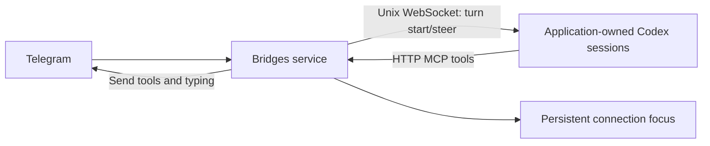

# Bridges MCP design

## Ownership

Bridges owns the authenticated HTTP MCP endpoint, one Telegram poller per bot,
attachment handles, typing refreshes, and persistent per-connection focus.
Applications own Codex App Server processes, subscription login, model settings,
conversation creation/resumption, workspace instructions, and startup turns.
Bridges must never launch an application or call `thread/start` or `thread/resume`.

An application registers a local App Server socket in Bridges configuration and
connects to the MCP URL with its assigned bearer token. The HTTP authentication
layer determines client identity. Thread/turn identity comes from host metadata;
neither is accepted as a tool argument. Validate the calling session against that
client's App Server before focus or communication operations. Tokens for different
applications must be unique. Tool arguments cannot select arbitrary sockets.

## Focus

`focus(connection_id)` selects the authenticated client's current, loaded session.
Store one `{client_id, thread_id}` target per connection in `focus.json`, replacing
the complete file atomically. File and directory synchronization make successful
writes durable. An instance process lock protects the map and bot pollers from a
second server using the same state directory.

No connection has an implicit initial focus. The MCP's instructions describe
communication tools but do not tell agents to focus connections. Selection policy
belongs in application instructions such as AGENTS.md.

A per-connection async lock serializes focus changes, inbound submission, and
typing changes. Last successful focus wins. Failed validation or failed persistence
must not publish a new in-memory route. A focus change stops the old session's
typing refresh for that connection; other connections and sessions continue.
Already-submitted input cannot be recalled. Queued input resolves focus when it
is submitted, so it never fans out to old and new sessions.

Persistent focus is routing state, not ownership of a conversation. Application
unavailability never causes automatic reassignment or conversation resumption.
Unfocused/unavailable destinations are dropped with local diagnostics. No durable
inbox, replay service, or exactly-once guarantee is provided.

## Delivery and lifecycle

Use the application's configured Unix WebSocket and the installed App Server
JSON-RPC protocol. Initialize the connection once; reconnect after disconnection.
The application keeps its own controlling client attached and its sessions loaded.
Bridges obtains status with `thread/read` and active turn IDs with
`thread/turns/list`. A one-second observer refreshes known session lifecycles;
notifications, when available, update state immediately. No thread/resume call is
used for subscription or monitoring.

Each session has independent state, snapshot and delivery locks. Active turns
receive `turn/steer` with `expectedTurnId`. Idle loaded sessions receive
`turn/start`. Unloaded or unknown sessions are unavailable. A definite stale-turn
rejection permits one bounded reconciliation retry; uncertain submissions are
never retried. Stale completion events cannot clear a newer active turn.

Waiting for approval/input remains active. Bridges never resolves approvals.
Applications configure reviewers and provide operator interaction independently.
Stopping Bridges cancels its observers and clients, never the App Server process.

## Telegram and typing

Normalize supported text/photo/voice/audio/document updates to an `Inbound` value
with a trusted connection ID separate from rendered text. The prompt header is
fenced YAML `bridge_context`, including the incoming `message_id` and optional
`reply_to_message_id` for same-chat replies, followed by a blank line and unchanged
body. There is no `---` separator. Telegram chat/file IDs and token-bearing URLs
stay server-side; message IDs are exposed for correlation.

Outbound communication tools select explicit destinations and do not alter focus.
A configured application session can send to configured connections; focus grants
inbound routing and typing ownership, not an outbound forwarding rule.
Text and photo/file captions use Telegram MarkdownV2. Tool docs specify escaping;
markup passes through unchanged and invalid markup has no plain-text fallback.

After an incoming message is accepted, its delivery acknowledgement identifies
the owning turn. Start a background typing task immediately for that connection
only if the accepted turn remains observable and active. No MCP typing tool is
exposed. An acknowledgement for a completed or replaced turn cannot start typing.
Steering more messages into the same turn is idempotent. Refresh about every four
seconds, stopping on completion, interruption, replacement, uncertainty,
disconnection, focus transfer, or shutdown. Wait for cancellation of pending
refreshes before completing a focus transfer. Close typing tasks before Telegram
clients. Telegram's visible indicator can linger for its remaining expiry time.

Typing sends and retries are best effort and run outside the delivery worker;
network failures and rate limits cannot block messages or other connections.
Focus alone and rejected/uncertain deliveries never start typing.

Attachment handles are connection-scoped, bounded, and ephemeral. Downloads use
generated paths and return original names as metadata. File paths are local to
the common host. Unknown/expired handles fail explicitly. Audio is not transcribed.
Send outcomes distinguish acknowledged, definite rejection, and unknown; partial
batches retain acknowledged IDs. No automatic retry of ambiguous mutations.

## Configuration and scope

See [the example](examples/app-server.yaml) and [deployment](docs/deployment.md).
All bot and application credentials are environment variables, not YAML secrets.
Only loopback HTTP is exposed. The configured Unix socket is protected by host
filesystem permissions. Codex App Server is the current delivery backend; HTTP
MCP compatibility alone does not implement delivery into other harnesses.

The registry generates both schemas and protocol docs. Unconfigured Telegram
tools, including focus when no connections exist, are omitted. No test bridge,
desktop IPC, application-specific agent, Discord, cron, or transcription is part
of this package. Tests use fixtures and independently owned App Server processes.
